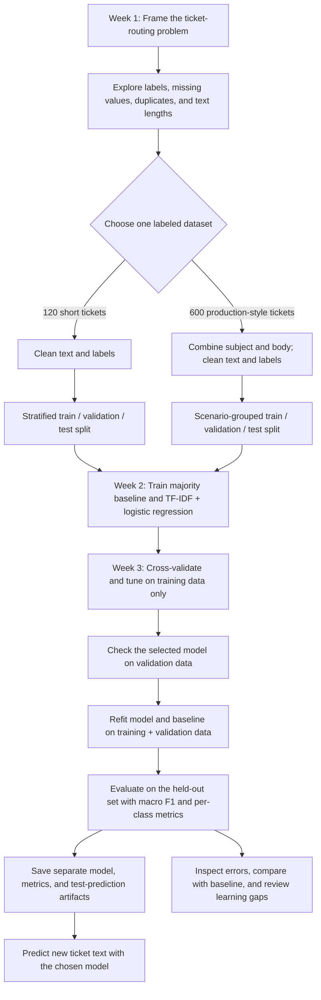

# Module 1: Support ticket classifier

## Problem statement

Route incoming support messages to **account**, **billing**, or **technical** queues. The input is the ticket text; the output is one queue label. This is supervised multiclass classification. A human should review low-confidence or ambiguous predictions before routing in a real service.

The original local experiment used 120 hand-written example tickets, 40 per class. They are instructional data, not production tickets or an unbiased performance benchmark. The public repository omits the local ticket CSVs because support-message data and customer-like identifiers should not be published without a separate review. Run `python generate_demo_data.py` to create clearly synthetic replacement CSVs in `data/`; this keeps any existing local CSVs unless `--force` is given. The generated examples may produce different metrics from the results recorded here. Gather real, consented historical tickets and evaluate on a later time period before deployment.

The local `data/production_style_tickets.csv` contains 600 longer, labeled, production-style examples with subjects, bodies, timestamps, customer IDs, and scenario IDs. The public demo generator creates a simpler synthetic file with the fields needed by the training pipeline. The file is handled as a separate experiment; it does not replace the original model or its reported test results.

## Module 1 flowchart



Each dataset follows this flow in a **separate training run**. The production-style branch keeps all variations of a scenario in one split. The existing test sets have already been inspected across multiple model runs, so their scores are exploratory; use fresh, later data for a final estimate. The exploration notebook and results files provide the Week 1 and Week 3 evidence.

## Tools by responsibility

**Module 1 required tools are bold.** The remaining tools belong to later modules of the 16-week program; they are listed here for planning and are not dependencies of this classifier.

| Responsibility | Suggested tools | Module 1 use |
|---|---|---|
| Data preparation and analysis | **NumPy, pandas** | Dataset checks and exploration |
| Visualization | **Matplotlib, Seaborn** | Exploration notebook charts |
| Traditional machine learning | **scikit-learn** | Splits, pipeline, tuning, and metrics |
| Deep learning | PyTorch | Later module |
| Pretrained models and adaptation | Transformers, PEFT | Later module |
| Diffusion workflows | Diffusers | Later module |
| Retrieval storage | FAISS or Chroma | Later module; choose one when needed |
| LLM workflow orchestration | LangChain | Later module |
| Application API | FastAPI | Later module |
| Demonstration interface | Streamlit | Later module |
| Testing and packaging | **pytest**, Docker | pytest runs this module's tests; Docker is later |
| Experiment tracking | MLflow | Later module |

`requirements.txt` contains the Module 1 Python dependencies. Jupyter runs the notebook, and joblib saves the trained scikit-learn model. Docker is a separate system tool. Install the later-module tools when those projects begin so their versions can be checked together.

## Setup

Python 3.10 or newer is recommended. Run all commands below from this project folder:

```bash
python3 -m venv .venv
source .venv/bin/activate
python -m pip install -r requirements.txt
python generate_demo_data.py
```

The generator creates `tickets.csv` (120 rows), `production_style_tickets.csv` (600 rows), and `real_style_tickets_v2.csv` (603 rows) when they are absent. These are simple teaching fixtures, not copies of the local experiment data. Keep private or consented datasets out of a public Git commit.

Open `01_explore.ipynb` in Jupyter for cleaning checks, class balance, text-length plots, and example records.

## Model 1: original example tickets

`data/tickets.csv` has 120 short, labeled examples in `text,label` columns. Train from scratch and run a manual prediction:

```bash
python ticket_classifier.py train --overwrite
python ticket_classifier.py predict "My invoice has the wrong tax amount"
```

The `train` command evaluates a majority-class baseline and the classifier on a 24-ticket held-out test set, then writes:

| File | Purpose |
|---|---|
| `artifacts/model.joblib` | Trained original model; the default for `predict` |
| `artifacts/model_metadata.json` | Target name, source file hash, and training time for new runs |
| `artifacts/metrics.json` | Cross-validation, validation, baseline, and held-out test metrics |
| `artifacts/test_predictions.csv` | Held-out ticket text, true label, prediction, and correctness |

The split is stratified at the ticket level: 72 train, 24 validation, and 24 test examples. The original model's recorded test macro F1 is **0.7111**, versus **0.1667** for its majority-class baseline. To inspect a known test failure, run:

```bash
python ticket_classifier.py predict "How do I update the billing address"
```

That message's true label is billing, but the saved original model predicts account. Manual `predict` calls illustrate behavior; only the held-out predictions and labels in `metrics.json` and `test_predictions.csv` produce scored test results.

## Model 2: production-style tickets

`data/production_style_tickets.csv` has 600 labeled rows with `subject,body,label` and other fields. Train a **separate model** from this file:

```bash
python ticket_classifier.py train --data data/production_style_tickets.csv --overwrite
python ticket_classifier.py predict $'Invoice question\n\nThe tax amount on our annual subscription invoice looks wrong.' \
  --model artifacts/production_style_tickets/model.joblib
```

The loader combines `subject` and `body` as text. At prediction time, pass the same kind of combined text as the quoted argument; `predict` does not read a CSV row. It excludes `scenario_id`, `customer_id`, timestamps, labels, and other metadata from features. Seven exact duplicate combined texts are removed, leaving 593 examples. Scenario IDs stay together across train, validation, test, and cross-validation folds because several tickets are variations of the same scenario.

| File | Purpose |
|---|---|
| `artifacts/production_style_tickets/model.joblib` | Trained production-style model; select it with `--model` |
| `artifacts/production_style_tickets/model_metadata.json` | Target and source provenance for new runs |
| `artifacts/production_style_tickets/metrics.json` | Cross-validation, validation, baseline, and held-out test metrics |
| `artifacts/production_style_tickets/test_predictions.csv` | Held-out ticket ID, true label, prediction, and correctness; bodies are not copied |

The scenario-grouped split has 355 train, 119 validation, and 119 test examples. The production-style model's recorded held-out macro F1 is **0.6173**, versus **0.2159** for its majority-class baseline. The original model scored **0.6772** on those same 119 tickets; details are in `RESULTS.md`. The original model remains the default CLI artifact for continuity. These test scores were inspected during development and should not be used as an untouched final comparison.

## Real-style v2: issue label or routed queue

The local `data/real_style_tickets_v2.csv` has two different targets: `label` describes the issue, while `agent_routed_queue` records a routing queue. The default training target is `label`. In one local example, the issue label is **billing** while the routed queue is **technical**. Decide which question the model should answer before training. The two targets disagree on 359 of 1,500 local source rows. The generated demo file has different rows and counts.

```bash
# Audit each target before excluding any rows.
python ticket_classifier.py audit --data data/real_style_tickets_v2.csv
python ticket_classifier.py audit --data data/real_style_tickets_v2.csv --target agent_routed_queue

# Predict the issue category. Explicitly exclude 194 rows labeled "other".
python ticket_classifier.py train --data data/real_style_tickets_v2.csv \
  --drop-unsupported --output artifacts/real_style_tickets_v2_reviewed --overwrite
python ticket_classifier.py predict 'I received a failed-payment message, but my bank shows a charge' \
  --model artifacts/real_style_tickets_v2_reviewed/model.joblib

# Predict the recorded route. Explicitly exclude all 36 rows in 15 conflicting-text groups.
python ticket_classifier.py train --data data/real_style_tickets_v2.csv \
  --target agent_routed_queue --drop-conflicts \
  --output artifacts/real_style_tickets_v2_queue_reviewed --overwrite
python ticket_classifier.py predict 'I received a failed-payment message, but my bank shows a charge' \
  --model artifacts/real_style_tickets_v2_queue_reviewed/model.joblib
```

Both runs use scenario-grouped splits when scenario IDs are present and exclude the target and routing metadata from text features. Training stops on unsupported targets or conflicting identical text unless the relevant drop flag is supplied. `audit` lists conflicting ticket IDs for manual review, and each run saves exclusion counts in `metrics.json`. With those explicit exclusions, the local issue-label run retained 1,278 rows and the route run retained 1,448. The latter's exploratory test macro F1 is **0.6937** versus **0.2122** for its majority baseline. A single phrase such as “technical issue” does not force a technical prediction; the model scores the full text. Editing a CSV also does not change a saved model until its `train` command runs again.

New model files have `model_metadata.json` with the target column, source CSV SHA-256, source text hashes, and training timestamp. `predict` identifies its output as `issue_label` or `routed_queue` according to that metadata. Existing model files without metadata still work through their `metrics.json` when available.

Training refuses to overwrite an existing model unless you pass `--overwrite`. Omit it for a new artifact folder, or choose a new `--output` for each experiment. The examples above include `--overwrite` because those reviewed folders were created during this project review.

### Evaluate on future labeled tickets

After choosing a model using training cross-validation and validation results, collect a **new** labeled CSV. It must use the saved model's target column and contain at least five examples for each of the three queues. Then run, for example:

```bash
python ticket_classifier.py evaluate \
  --model artifacts/real_style_tickets_v2_reviewed/model.joblib \
  --data data/new_labeled_tickets.csv
```

`evaluate` does not retrain or change the model. It rejects the same source file and exact ticket text retained from that model's source CSV. It prints aggregate metrics and an exclusion audit without writing ticket bodies. Verify dates, customer separation, and label quality before treating the result as a final performance estimate; the command cannot establish those properties on its own. New models record source text hashes for this check. The older artifacts must be retrained before they can use `evaluate`.

## Check both testing scenarios

After training, inspect the false predictions and test metrics separately:

```bash
python -m pytest -q
python -c "import pandas as pd; print(pd.read_csv('artifacts/test_predictions.csv').query('correct == False').to_string(index=False))"
python -c "import pandas as pd; print(pd.read_csv('artifacts/production_style_tickets/test_predictions.csv').query('correct == False').to_string(index=False))"
```

The pytest suite checks both workflows, including that a production-style `scenario_id` cannot occur in more than one split. The `train` commands use **only their selected CSV**, retrain from scratch, and keep their artifacts separate. They do not merge the datasets. The model files use Python's pickle format; load only artifacts created by a trusted source.

## Workflow and assessment

1. `load_data` strips blank text, audits unsupported targets and conflicting duplicate text, and removes same-target duplicates. Unsupported or contradictory rows require an explicit exclusion choice. It checks that each class has enough rows.
2. The original data uses a fixed-seed stratified 60/20/20 train/validation/test split. The production-style data uses a fixed-seed stratified group split with approximately the same proportions, keeping each scenario in one partition.
3. A majority-class dummy classifier is the baseline. The candidate is a TF-IDF vectorizer followed by logistic regression.
4. Three-fold stratified cross-validation on the training split chooses unigram/bigram features and regularization strength by **macro F1**. The validation split gives a separate check of the selected settings.
5. The selected model is fitted again on training plus validation data. Both it and the baseline are evaluated once on the untouched test split.

Macro F1 gives each queue equal weight and balances precision with recall. Accuracy alone could hide poor performance on a smaller queue. The JSON report also includes per-class precision, recall, F1, support, and a confusion matrix. If missing a particular category has a much higher business cost, use a cost-sensitive metric and collect more representative data.

**Leakage prevention:** The TF-IDF vocabulary is inside the scikit-learn pipeline, so each cross-validation fold fits it only on that fold's training examples. The test set is excluded from tuning and refitting within a run. Duplicate text is handled before splitting. Near-duplicate templates and repeated customer issues could still leak across splits in a real dataset; group by customer or issue and use a time-based final test when those fields exist. Because the present test results have already informed model choices, they are exploratory, not final proof of deployment performance.

For the production-style file, `scenario_id` provides that issue-level grouping. It is an evaluation control, not a predictor. This guards against near-duplicate scenarios crossing splits, but it does not measure future time drift. If the file is replaced with real support data, also check consent, retention, and whether a customer- or time-held-out test better matches deployment.

## Module 1 scope

This milestone demonstrates classification, preprocessing, cross-validation, hyperparameter tuning, metrics, and error analysis. The exploration notebook uses NumPy, pandas, Matplotlib, and Seaborn. Regression and clustering are separate learning topics; they are not forced into a text-routing application. For review, compare the work with your detailed Module 1 breakdown and record any missing topics.

## Known limits

- The dataset is small, balanced, and hand-authored. Test results measure performance only on these examples.
- There is no confidence threshold, multilingual support, privacy workflow, or drift monitoring.
- If all messages belong outside the three known queues, the model still predicts one of them.

## Next iteration

Collect anonymized real tickets with timestamps and customer IDs; define a label policy and an “other” queue; split by time or customer; review errors with support staff; then set a confidence threshold using validation data.
