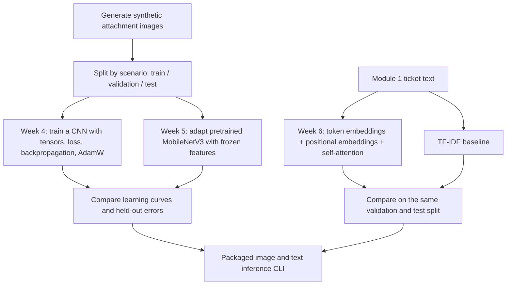

# Module 2: Deep learning for support ticket attachments

## Objective and project milestone

Extend the Module 1 ticket router with **image categorization**. A ticket attachment is classified as an account, billing, or technical screenshot. Module 2 also includes a small text self-attention experiment to teach embeddings and transformer fundamentals. The app keeps text and image predictions separate because this project has no paired text-image training labels.

The 240 attachment images are **synthetic teaching examples**, generated by this project rather than collected from support traffic. They resemble login forms, invoices, and error screens. Their scores do not estimate accuracy on real screenshots or document scans.

## Tools used in this module

| Responsibility | Required tools | Use here |
|---|---|---|
| Neural networks and attention | **PyTorch** | CNN training loop and transformer encoder |
| Pretrained image model | **torchvision** | MobileNetV3 Small weights, transforms, and transfer learning |
| Image creation and loading | **Pillow** | Reproducible synthetic attachments |
| Analysis and training curves | **NumPy, pandas, Matplotlib** | Manifests, metrics, and plots |
| Traditional text baseline | **scikit-learn** | TF-IDF and logistic regression comparison |
| Verification | **pytest** | Dataset, model, and inference checks |

The Week 6 attention model uses PyTorch's `nn.TransformerEncoder`; it does not require the Hugging Face Transformers package. That package and PEFT become relevant when adapting larger pretrained language models in later modules.



## Setup

Use Python 3.10 or newer. From this folder:

```bash
python3 -m venv .venv
source .venv/bin/activate
python -m pip install -r requirements.txt
```

The transfer-learning run downloads official torchvision MobileNetV3 Small weights on first use and caches them under `artifacts/torch/`. It will stop with an error if the weights are unavailable; it does not silently use an untrained model. The scratch CNN and text experiment need no model download.

## Week 4: PyTorch training loop

Generate the image dataset and train the CNN from random initialization:

```bash
python generate_data.py
python image_model.py train --arch scratch --epochs 25
```

`generate_data.py` creates 20 scenarios per class and four visual variants per scenario. The manifest has **144 training**, **48 validation**, and **48 test** images. Entire scenarios are assigned to one split so a visual variant of the same ticket cannot appear in both training and testing. Inspect `data/generated/manifest.csv` and sample files in `data/generated/images/`.

The `SmallCNN` applies convolutions, GroupNorm, ReLU activations, pooling, dropout, and a linear classifier. The training loop computes cross-entropy loss, calls `loss.backward()`, and updates trainable weights with AdamW. It tracks training and validation loss and macro F1, retains the best validation checkpoint, then evaluates the held-out test images.

## Week 5: transfer learning and augmentation

```bash
python image_model.py train --arch mobilenet --epochs 12
```

This loads ImageNet-pretrained MobileNetV3 Small, freezes its feature extractor and BatchNorm statistics, replaces the final classifier layer, and trains that classifier on the attachment dataset. Training applies small affine shifts and brightness/contrast changes; validation and test images receive only deterministic resizing and normalization. This is a small demonstration of feature transfer, not evidence that ImageNet features are optimal for documents.

Both image runs write `model.pt`, `history.csv`, `training_curves.png`, `metrics.json`, and `test_predictions.csv` under their own folders in `artifacts/`. The CSV lists image path, true label, prediction, and correctness.

## Week 6: embeddings and self-attention

```bash
python text_attention.py train
```

The text exercise reads 120 Module 1 tickets. In a fresh public checkout, first run `python '../Module 1 - Machine Learning Ticket Classifier/generate_demo_data.py'` to create synthetic ticket fixtures; the recorded results below came from the different local hand-written dataset. The experiment builds a vocabulary **only from training text**, maps unseen words to `<unk>`, and pads sequences to a fixed length. `TicketTransformer` adds token and position embeddings, applies one multi-head self-attention encoder layer with a padding mask, pools the sequence, and predicts a queue. It compares against a TF-IDF + logistic regression baseline trained on the same 72 examples. Validation has 24 examples, and test has 24.

The saved text files are in `artifacts/text_attention/`: `model.pt` for the attention model, `tfidf_baseline.joblib`, `history.csv`, `training_curves.png`, `metrics.json`, and `test_predictions.csv`. The baseline scored higher on validation, so it is the default text predictor in the app. The attention model remains available for study.

## Demonstration app

```bash
python app.py image data/generated/images/billing/billing-19-00.png
python app.py image data/generated/images/technical/technical-19-00.png --model artifacts/scratch/model.pt
python app.py text 'Please send the invoice for this month'
python app.py text 'Please send the invoice for this month' --model artifacts/text_attention/model.pt
```

`app.py image` uses the pretrained MobileNet artifact by default; `app.py text` uses the validated TF-IDF baseline by default. Pass an explicit model path to compare alternatives. The numerical outputs are model scores and are not calibrated confidence guarantees.

## Evaluate and review

```bash
python -m pytest -q
```

Read [RESULTS.md](RESULTS.md) and open each `training_curves.png`. Explain which curve shows overfitting, why validation selection matters, and why high accuracy on synthetic images is not a production claim. The test images and Module 1 ticket test split have been inspected during development, so the recorded scores are learning evidence rather than a fresh final benchmark.

To move toward real use, obtain consented, labeled attachment images, document the label policy, add a class for unsupported attachments, and evaluate on future tickets from customers and scenarios absent from training. Do not mix private customer images into this synthetic teaching dataset.
