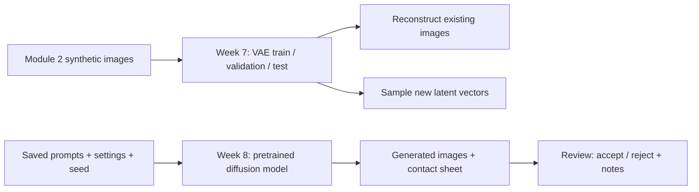

# Module 3: Generative AI visual assets

## Objective

Learn reconstruction, latent sampling, and controlled diffusion generation. This module extends the support application with **generic visual assets** for documentation or demos. Generated images must be reviewed before use; they are not ticket evidence and do not alter the Module 1 or Module 2 classifiers.

## Required tools

| Responsibility | Required tool | Role in this module |
|---|---|---|
| VAE, tensors, training | **PyTorch** | Encoder, latent distribution, decoder, training loop |
| Pretrained diffusion | **Diffusers** | Load and run a text-conditioned image model |
| Prompt encoding and model loading | **Transformers**, **Hugging Face Hub**, **safetensors**, **Accelerate** | Diffusion pipeline dependencies |
| Image I/O and analysis | **Pillow**, **NumPy**, **Matplotlib** | Resize images, contact sheets, plots |
| Verification | **pytest** | VAE and saved-run tests |

PEFT, FAISS/Chroma, LangChain, FastAPI, Streamlit, Docker, and MLflow are not needed for these two learning exercises. Module 3 is a command line application with file based review records.



## Setup

Use Python 3.10 or newer. From this folder:

```bash
python3 -m venv .venv
source .venv/bin/activate
python -m pip install -r requirements.txt
```

The Module 2 teaching images and `data/generated/manifest.csv` are included in the repository. If you remove them, regenerate them with:

```bash
python '../Module 2 - Deep Learning Ticket Attachments/generate_data.py'
```

## Week 7: VAE reconstruction and sampling

```bash
python vae.py --epochs 12 --beta 0.05
```

The VAE trains on **144** synthetic images, selects the best checkpoint on **48** validation images, and measures loss on **48** held out images. It shrinks images to 64×64, encodes them as a 16 dimensional Gaussian latent distribution, samples a latent vector during training, and decodes it. The loss is image reconstruction MSE plus `beta × KL divergence`. Lower loss is better within this experiment; it is not an image quality score.

Open [the VAE notebook](notebooks/01_vae_reconstruction_and_sampling.ipynb) to display originals beside reconstructions, sample from the latent prior, and interpolate between two encoded images. `artifacts/vae/` also contains the checkpoint, `history.csv`, `metrics.json`, `reconstructions.png`, `samples.png`, and `training_curves.png`.

**Reconstruction** starts with an existing image and asks the model to reproduce it. **Generation** samples a new latent vector or denoises noise; it does not need an input image. The VAE samples will often blur small text because of the 64×64 size, tiny dataset, and pixel loss.

## Week 8: diffusion generation and review

Edit [the saved run configuration](configs/asset_run.json) to set prompts, a negative prompt, seed, model ID, output size, inference steps, and guidance scales. The example uses [Segmind Tiny-SD](https://huggingface.co/segmind/tiny-sd), a compact text-conditioned pretrained model. Its weights are approximately 1 GB and are downloaded on first use. The example uses 256×256 images; CPU generation can still be slow. Review the model card and license before any external use.

```bash
python diffusion_app.py generate --config configs/asset_run.json
```

For a faster, lower resolution check, run `python diffusion_app.py generate --config configs/quick_check.json`. Its images are for verifying the workflow and assessing setting changes, not for publishing.

Each run gets a new folder under `artifacts/diffusion_runs/` with the exact configuration, generated PNGs, `contact_sheet.png`, and `review.json`. For each prompt, both settings reuse the same seed to make the comparison more interpretable. Differences can still reflect nonlinear model behavior; a single image pair does not establish that one setting is generally better.

Inspect the contact sheet and each full size image for clarity, visual artifacts, unwanted text/logos, and fit to the requested asset. Record a decision and a reason:

```bash
python diffusion_app.py review artifacts/diffusion_runs/RUN_ID prompt-01-setting-01.png \
  --decision accepted --notes 'Clear icon; no unwanted text'
python diffusion_app.py review artifacts/diffusion_runs/RUN_ID prompt-01-setting-02.png \
  --decision rejected --notes 'Unwanted lettering'
```

Use the actual run folder printed by `generate` in place of `RUN_ID`. The output review file begins with `pending` for every image. Keep accepted images and their saved configuration together when presenting an asset; do not treat the model output as a verified screenshot or real customer record.

To try another compatible text-to-image Diffusers model, change `model_id` in the JSON. GPU, memory, access terms, scheduler, and supported parameters vary by model. The optional `revision` field can pin a model revision for stronger reproducibility.

## Test scenarios

Run these from the Module 3 folder after setup. `artifacts/` contains local outputs and can be regenerated. The quick diffusion check downloads the pretrained model on first use and is slower on a CPU.

| Scenario | Steps | Expected result |
|---|---|---|
| Automated checks | Run `python -m pytest -q` | The VAE shape/loss check, saved diffusion run check, and invalid configuration check pass. These tests use a fake diffusion pipeline and do not assess image quality. |
| VAE training and saved outputs | Run `python vae.py --epochs 12 --beta 0.05` | `artifacts/vae/` contains `model.pt`, `history.csv`, `metrics.json`, `training_curves.png`, `reconstructions.png`, and `samples.png`. Metrics report 144/48/48 train/validation/test images. |
| Reconstruction versus generation | Open `notebooks/01_vae_reconstruction_and_sampling.ipynb` after training and run its cells | Reconstructions have a corresponding input image; sampled images do not. Check whether layout, small text, and icons survive. Blurry outputs are a limitation to record, not a test failure. |
| Latent regularization comparison | Run `python vae.py --epochs 12 --beta 1.0 --output artifacts/vae_beta1`, then compare the two image grids and curves | The second run is saved separately. Discuss how a stronger KL term changes reconstruction and samples; do not compare total losses as if they used the same objective. |
| Diffusion settings comparison | Run `python diffusion_app.py generate --config configs/quick_check.json` | The printed run folder has two PNGs, `config.json`, `contact_sheet.png`, and `review.json`. Both images use the same prompt and seed; one uses 4 steps/guidance 4 and the other 8 steps/guidance 7. Both reviews start as `pending`. |
| Review decisions | Inspect both PNGs, then use the review commands below | `review.json` changes only for the named image and retains its prompt, seed, settings, decision, and notes. Reject images with unwanted lettering, poor clarity, or a poor match to the prompt. |
| Invalid inputs | Run the examples below | A zero-step configuration is rejected before loading weights; an image name absent from `review.json` is rejected without changing the review file. |

For the review scenarios, replace the example run folder with the path printed by your `generate` command:

```bash
python diffusion_app.py review artifacts/diffusion_runs/RUN_ID prompt-01-setting-01.png \
  --decision rejected --notes 'Blurry at low resolution'
python diffusion_app.py review artifacts/diffusion_runs/RUN_ID prompt-01-setting-02.png \
  --decision rejected --notes 'Does not clearly show a support inbox'
```

The decisions above are **examples**. Base the actual decisions on the images you see. To check error handling without editing a configuration file:

```bash
python -c "from diffusion_app import validate_config; validate_config({'model_id':'x','prompts':['icon'],'seed':42,'settings':[{'steps':0,'guidance_scale':4}]})"
python diffusion_app.py review artifacts/diffusion_runs/RUN_ID missing.png --decision accepted
```

Both commands should exit with an error. If a generation run is interrupted, its folder may contain only `config.json` or a partial set of images; use a completed run with `contact_sheet.png` and `review.json` for review.

## Assessment

1. Explain why a reconstruction has an input image while a generated sample does not.
2. Compare VAE originals, reconstructions, and samples. Identify blurred text or collapsed structure.
3. Compare diffusion outputs for the same prompt and seed with two step/guidance settings, then record accept/reject reasons.
4. Document the model and data source. The VAE images are synthetic educational data. Diffusion outputs may have artifacts, poor text rendering, biases, or uncertain suitability for a given use; review rights and model terms before publication.

```bash
python -m pytest -q
```

Training a diffusion model from scratch is outside the required scope.
