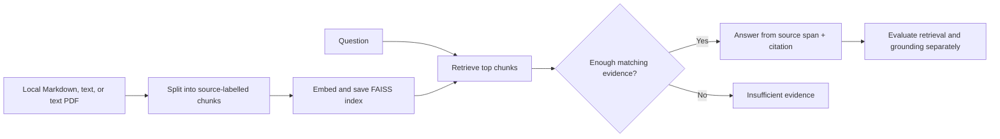

# Module 4: Document-grounded support assistant

## Objective and milestone

Build a support knowledge assistant that ingests documents, retrieves relevant passages, answers with source references, and says when the documents do not support an answer. Week 9 covers chunking, embeddings, retrieval, prompting, and structured JSON answers. Week 10 adds a read-only tool workflow and a small parameter-efficient adaptation experiment.

The four included support guides are **fictional teaching data**, not real policy. Their nine evaluation questions are also hand-written for this small collection. A high score on them is a workflow check, not evidence of production quality.

## Tools used

| Responsibility | Module 4 tool | Use here |
|---|---|---|
| Document splitting and workflow | **LangChain text splitters**, **LangChain Core** | Recursive chunks and an allowlisted tool pipeline |
| Embeddings | **sentence-transformers** or **scikit-learn** | MiniLM semantic vectors or a local hashing baseline |
| Retrieval storage | **FAISS** | Saved cosine-similarity index |
| Language model and adaptation | **Transformers**, **PyTorch**, **PEFT** | Optional FLAN-T5 answer candidate and LoRA routing experiment |
| Document loading | **pypdf** | Text extraction from text-based PDFs |
| Verification | **pytest** | Ingestion, evidence, abstention, tools, and data checks |

The sample workflow runs locally. No API key is needed. MiniLM and FLAN-T5 download pretrained weights on first use; the hashing baseline and extractive answer mode work without model downloads after Python packages are installed. The models are [MiniLM](https://huggingface.co/sentence-transformers/all-MiniLM-L6-v2) and [FLAN-T5 small](https://huggingface.co/google/flan-t5-small).

See [RESULTS.md](RESULTS.md) for the actual sample run, including the limited LoRA outcome.



## Setup

Use Python 3.10 or newer. Run these commands from the Module 4 folder:

```bash
python3 -m venv .venv
source .venv/bin/activate
python -m pip install -r requirements.txt
```

All generated indexes, model caches, and adapters live under ignored `artifacts/`. Keep private documents in a local folder outside Git.

## Week 9: ingest, retrieve, and answer

### 1. Inspect and index the sample documents

Read `sample_docs/account_access.md`, `billing_policy.md`, `technical_help.md`, and `support_hours.md`. Then build an offline baseline index:

```bash
python knowledge_assistant.py ingest --docs sample_docs --index artifacts/hash_index --embedding hash
```

Expected: `manifest.json` reports **4 documents and 5 chunks** at the default chunk size. The folder also contains `chunks.json` with source IDs and `vectors.faiss`. Re-running the same output path requires `--overwrite`; this prevents accidental replacement. The saved manifest records source file hashes, chunk size, overlap, and embedding method.

### 2. Ask answerable and unanswerable questions

```bash
python knowledge_assistant.py ask 'How do I reset my password?' --index artifacts/hash_index
python knowledge_assistant.py ask 'What is the CEO salary?' --index artifacts/hash_index
```

Expected: the password answer quotes the `account_access.md` passage and includes a `chunk_id`, source, retrieval score, and evidence text. The salary question returns `insufficient_evidence` with no citation. The assistant requires at least two meaningful question terms in a source sentence. This simple rule can reject valid short or paraphrased questions, and it is not a complete hallucination detector.

### 3. Evaluate retrieval separately from answer grounding

```bash
python knowledge_assistant.py evaluate --index artifacts/hash_index --questions eval/questions.jsonl
```

The report includes retrieval recall@3 and reciprocal rank, answer phrase match, verbatim grounding, and abstention on two unsupported questions. On the included nine-case fixture, the hashing baseline scored **1.00** on all five measures after fixing a false answer to a solar-eclipse question. These questions were written for the same four documents, so the score is instructional only. Add unrelated documents and paraphrased questions before drawing a broader conclusion.

### 4. Index your own documents

`--docs` accepts a folder of UTF-8 `.md` and `.txt` files and text-based `.pdf` files. Image-only scans need OCR, which is planned for Module 5. For a disposable upload-style check:

```bash
mkdir -p artifacts/my_docs
printf 'Demo warranty period: 30 days.\n' > artifacts/my_docs/warranty.txt
python knowledge_assistant.py ingest --docs artifacts/my_docs --index artifacts/my_index
python knowledge_assistant.py ask 'What is the demo warranty period?' --index artifacts/my_index
```

Expected: the answer is grounded in `warranty.txt`. A question about billing should abstain because that index contains no billing document. Each index is separate; ingesting one folder does not add it to another index.

### 5. Compare learned embeddings and optional LLM prompting

```bash
python knowledge_assistant.py ingest --docs sample_docs --index artifacts/minilm_index --embedding minilm
python knowledge_assistant.py evaluate --index artifacts/minilm_index --questions eval/questions.jsonl
python knowledge_assistant.py ask 'How long do approved refunds take?' --index artifacts/minilm_index --mode flan
```

MiniLM compares semantic embeddings with the hashing baseline. `--mode flan` asks a small pretrained language model to draft an answer from retrieved evidence. The application uses the candidate only if it is a verbatim span of the cited passage; otherwise it returns the extractive answer and reports `extractive_fallback`. This conservative gate trades fluency for traceability. It does not guarantee the source itself is correct.

On the included nine-question fixture, MiniLM also scored 1.00 on the five reported measures. This small fixture cannot establish which embedding method generalizes better.

## Week 10: constrained tools and LoRA

### 6. Run the read-only tool workflow

```bash
python tool_workflow.py 'What is the status of DEMO-1002?' --index artifacts/hash_index
python tool_workflow.py 'How do I reset my password?' --index artifacts/hash_index
python tool_workflow.py 'What is the status of DEMO-9999?' --index artifacts/hash_index
```

The planner selects only `lookup_demo_ticket` or `search_docs`, and the JSON response records the tool call. The first question looks up a fictional status in `sample_data/ticket_status.json`; the second searches the document index; the unknown ID returns insufficient evidence. No arbitrary shell command or write tool is available. This is a deterministic, inspectable workflow for learning tool boundaries, not a general autonomous agent.

### 7. Run the guided parameter-efficient adaptation

```bash
python adapt_lora.py --data eval/route_examples.jsonl --steps 8
```

This downloads FLAN-T5 small, attaches LoRA to its attention query/value projections, trains only adapter parameters on 12 synthetic ticket-routing examples, and compares six held-out validation labels before and after adaptation. It saves `artifacts/lora_route/adapter/` and `report.json` with trainable fraction, losses, predictions, and accuracy. The experiment adapts a **stable output task** (routing labels); it does not teach the model the current support policy. For changing facts in documents, update the RAG index instead of expecting a small adapter to memorize them reliably.

The recorded eight-step run reached 2/6 correct labels after adaptation, up from 0/6. Several outputs still broke the requested one-label format; inspect `report.json` and [RESULTS.md](RESULTS.md) before treating the adapter as useful.

## Test scenarios and expected results

| Scenario | Command or action | Expected result |
|---|---|---|
| Automated behavior | `python -m pytest -q` | Ingestion, citations, abstention, chunking, overwrite guard, tool allowlist, and adaptation data checks pass without downloading weights. |
| Supported answer | Ask about password reset | `answered` with `account_access.md` citation and a source-backed sentence. |
| Unsupported answer | Ask about CEO salary or a solar eclipse | `insufficient_evidence`; no citation or fabricated fact. |
| Source separation | Index only `artifacts/my_docs` | Answers use only that folder's content; unrelated questions abstain. |
| Retrieval evaluation | Run the included nine questions | Retrieval and grounding measures are reported separately; examine per-question failures. |
| Tool boundaries | Ask for `DEMO-9999` or request a shell command | Unknown ID abstains; unrecognized actions cannot execute. |
| LoRA comparison | Run the 8-step experiment | Report shows baseline and adapted predictions; a higher score is not guaranteed on six examples. |

## Assessment and limits

Compare three approaches for a defined task:

| Approach | Best fit here | Limitation to explain |
|---|---|---|
| Prompting alone | Ask an existing model to follow an answer format | It does not supply the current support policy. |
| Retrieval plus prompting | Answer from changing uploaded documents with citations | Retrieval errors and stale or incorrect documents still affect answers. |
| LoRA adaptation | Practice a repeated output pattern such as three-way routing | A tiny run does not establish production improvement or replace a knowledge index. |

Before using real documents, check permission to ingest them, remove unnecessary personal information, and evaluate on questions written independently of the indexed source set. A citation proves where text came from, not that the policy is true or current.
