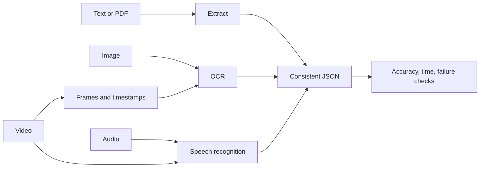

# Module 5: Multimodal support assistant

## Objective and tools

Weeks 11–12 process **text, images, short video, and audio** through a consistent JSON result: `input_type`, `source`, `status`, `summary`, `evidence`, `details`, and `processing_seconds`. The `speak` command saves a spoken answer. Module 6 will connect these processors into one API and user interface.

| Task | Required tools | Use here |
|---|---|---|
| Text/PDF | Python, **pypdf** | Read UTF-8 text and text-based PDF pages |
| Image | **Pillow**, **RapidOCR**, **ONNX Runtime** | Validate images and extract visible text |
| Video | **FFmpeg / ffprobe** | Check duration, sample frames, extract audio |
| Audio | **faster-whisper**, **PyAV** | English speech recognition with timestamps on CPU |
| Speech output | macOS `say` or **pyttsx3** | Save WAV/AIFF spoken response |
| Verification | **pytest** | Check format handling, empty input, and timestamps |

RapidOCR includes compact OCR weights ([installation guide](https://github.com/RapidAI/RapidOCRDocs/blob/main/docs/install_usage/rapidocr/install.en.md)); faster-whisper downloads `tiny.en` on first use ([usage guide](https://github.com/SYSTRAN/faster-whisper/blob/master/README.md)). `av<19` avoids a [known compatibility problem](https://github.com/SYSTRAN/faster-whisper/issues/1589). The included guide, receipt, clip, subtitles, and voice request are fictional teaching media.



## Setup

Use Python 3.10–3.12 and install FFmpeg with `ffmpeg` and `ffprobe` on PATH. Run from this folder:

```bash
python3 -m venv .venv
source .venv/bin/activate
python -m pip install -r requirements.txt
ffmpeg -version
```

Samples are committed under `sample_data/`, including a text PDF. `python make_samples.py` regenerates the PNG and MP4 (requires FFmpeg). Model downloads, spoken output, and evaluation reports are ignored under `artifacts/`.

## Week 11: text, image, and video

### 1. Text document

```bash
python multimodal.py text sample_data/guide.txt
```

Expected: `ok`, a summary mentioning password reset and refunds, page 1 evidence, and processing time. `.md` and text-based `.pdf` also work. Test the included PDF with `python multimodal.py text sample_data/guide.pdf`: it should mention the five-business-day refund rule. An image-only PDF has no extractable text and returns `insufficient_input`; OCR its pages first.

### 2. Receipt image and optional Module 2 categorization

```bash
python multimodal.py image sample_data/receipt.png
```

Expected: OCR lines `BILLING RECEIPT` and `Amount: $42.00`, confidence scores, and dimensions. A blank image returns `insufficient_input`. This baseline reads visible text; it does not explain arbitrary photos. To add the trained Module 2 attachment category, use its checkpoint and Python environment:

```bash
python multimodal.py image sample_data/receipt.png \
  --image-model '../Module 2 - Deep Learning Ticket Attachments/artifacts/scratch/model.pt' \
  --image-python '../Module 2 - Deep Learning Ticket Attachments/.venv/bin/python'
```

Expected: `details.attachment_category` contains label and probabilities. The category is omitted when no checkpoint is passed.

### 3. Short video with supplied subtitle transcript

```bash
python multimodal.py video sample_data/receipt_walkthrough.mp4 \
  --transcript sample_data/video_transcript.srt --interval 2
```

Expected: timestamped OCR evidence for the billing page and receipt download, subtitle cues at 0 and 2.5 seconds, and a summary of visual steps and narration. Videos are limited to two minutes and eight sampled frames. Sparse sampling may miss a brief action.

To transcribe the actual audio track instead of using the separate teaching subtitles:

```bash
python multimodal.py video sample_data/receipt_walkthrough.mp4 --transcribe
```

The audio track says “The customer needs a billing receipt.” With neither option, output uses frames alone. Compare transcript evidence and timestamps before relying on a video summary.

## Week 12: speech and evaluation

### 4. Audio transcription

```bash
python multimodal.py audio sample_data/billing_request.wav
```

Expected: a billing receipt transcript with start and end times. The first run downloads `tiny.en` into `artifacts/models/`. Speech recognition runs in a separate process from OCR to avoid conflicting macOS media libraries. The baseline is English-only and may mishear accents, names, or noise.

### 5. Spoken output

```bash
python multimodal.py speak 'Your receipt is ready.' --output artifacts/spoken_answer.wav
ffprobe -v error -show_entries format=duration -of default=noprint_wrappers=1 artifacts/spoken_answer.wav
```

Expected: a playable WAV with positive duration. macOS uses `say`; other systems use `pyttsx3` and need a working system voice engine. An empty or undecodable output raises an error.

### 6. Assessment and automated checks

```bash
python evaluate.py
python -m pytest -q
```

`evaluate.py` writes `artifacts/evaluation.json`: expected phrase checks and elapsed time for all four input types, plus empty text, blank image, and silent audio behavior. Use `python evaluate.py --skip-audio` to avoid the first speech model download. These fixed phrases are a smoke check, not a general accuracy benchmark. See [RESULTS.md](RESULTS.md) for a local run.

## Detailed test scenarios

| Scenario | Command or action | Expected behavior |
|---|---|---|
| Text | Process `guide.txt` | `ok`, summary and page evidence |
| Empty text | Process an empty `.txt` | `insufficient_input` |
| Receipt image | Process `receipt.png` | Two OCR lines including `$42.00` |
| Blank/corrupt image | Blank PNG or invalid image bytes | `insufficient_input` or explicit file error |
| Video + subtitles | Pass `--transcript` | Timestamped frame and subtitle evidence |
| Video + speech | Pass `--transcribe` | Timestamped frame and recognized speech evidence |
| Silent video audio | Transcribe a clip without sound | Frame evidence remains; zero speech segments |
| Audio | Process `billing_request.wav` | Billing receipt transcript |
| Silent audio | Process a silent WAV | `insufficient_input` |
| Speech output | Use `speak` and inspect with ffprobe | Decodable positive-duration file |
| Automated checks | `python -m pytest -q` | Seven tests pass without downloading weights |

OCR can miss blurry text, sampling can miss actions between frames, and transcription can omit or add words. Source evidence helps review a result; it does not prove the interpretation. Keep private customer media out of Git.
